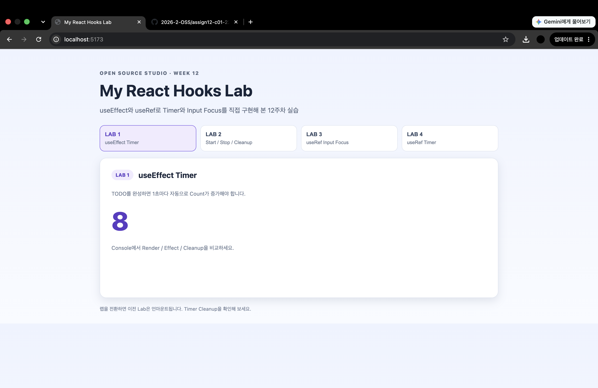
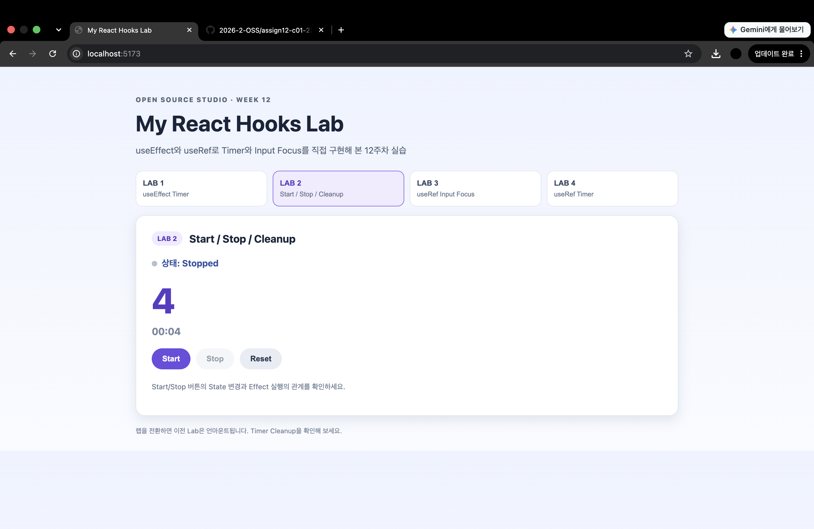
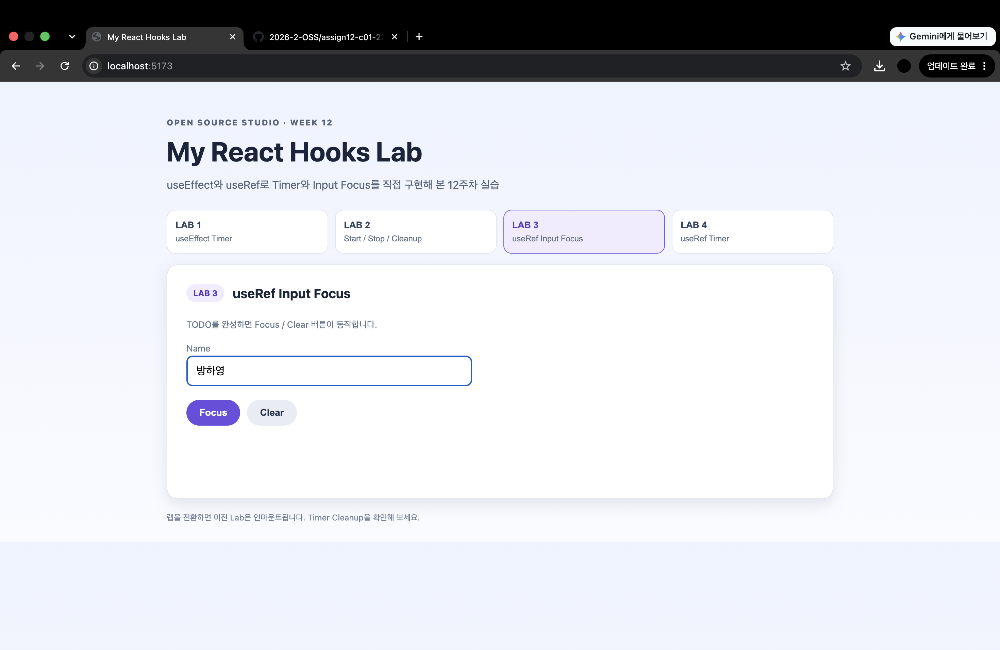
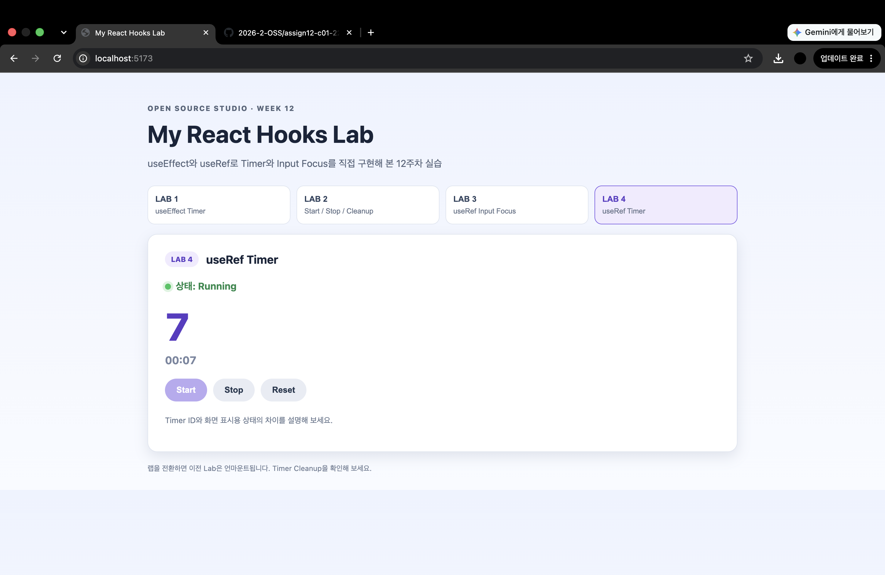

# My React Hooks Lab (OSS Week 12)

## 1. Project Information
- 12주차 React Hooks 실습 프로젝트입니다.
- 강의에서 제공한 Starter Project의 TODO를 완성해서 useEffect, useRef를 이용한 4개의 Lab을 구현했습니다.
- Starter Project: https://github.com/2026-2-OSS/week12_starter_project
- 사용 기술: React 19, Vite 6

## 2. Installation
```bash
npm install
npm run dev
```
- 터미널에 나오는 Local 주소(http://localhost:5173)로 접속
- 배포 전 확인: `npm run build`

실행 화면:



## 3. Source Code Exploration

### 3-1. 프로젝트 구조
```
src/
 ├─ App.jsx              # 탭 메뉴로 4개의 Lab 중 하나를 선택해서 보여줌
 ├─ App.css              # 공통 스타일
 ├─ main.jsx             # React 시작점 (StrictMode로 App 렌더링)
 ├─ utils/formatTime.js  # 초 → MM:SS 변환 (추가)
 └─ components/
     ├─ Lab1_EffectTimer.jsx   # useEffect 자동 Timer
     ├─ Lab2_TimerControl.jsx  # running State + useEffect로 Start/Stop/Reset
     ├─ Lab3_InputFocus.jsx    # useRef로 input Focus
     └─ Lab4_RefTimer.jsx      # useRef에 Timer ID 저장
```
- App.jsx는 `active` State로 현재 선택된 Lab을 저장하고, 해당 컴포넌트만 렌더링합니다.
- 그래서 탭을 바꾸면 이전 Lab 컴포넌트는 언마운트되고 Cleanup이 실행됩니다.

### 3-2. useEffect
- Effect: 렌더링 후에 실행되는 작업 (Timer, 이벤트 등록, API 요청 등 외부 작업)
- Dependency Array: Effect를 언제 다시 실행할지 정함
  - `[]` → 처음 마운트될 때 한 번
  - 생략 → 렌더링될 때마다
  - `[running]` → 처음 + running이 바뀔 때
- Cleanup: Effect에서 return하는 함수. Effect가 다시 실행되기 전이나 컴포넌트가 사라질 때 실행되어 이전 작업(타이머 등)을 정리함

### 3-3. useRef
- `useRef(초기값)`은 `{ current: 초기값 }` 객체를 반환하고, 이 객체는 리렌더링되어도 계속 유지됨
- `.current` 값을 바꿔도 리렌더링이 일어나지 않음 (useState는 값이 바뀌면 리렌더링됨)
- 그래서 화면에 보여줄 값은 useState, 화면과 상관없이 기억만 하면 되는 값(DOM 요소, Timer ID)은 useRef를 사용

### 3-4. 주요 코드 분석

**(1) useEffect — Lab2_TimerControl.jsx**
```jsx
useEffect(() => {
  if (!running) return;
  const timerId = setInterval(() => {
    setCount(prev => prev + 1);
  }, 1000);
  return () => {
    clearInterval(timerId);
  };
}, [running]);
```
- Start를 누르면 running이 true가 되고, Dependency Array에 running이 있어서 Effect가 다시 실행되어 타이머가 생성됩니다.
- Stop을 누르면 running이 false로 바뀌는데, 이때 Effect가 다시 실행되기 전에 이전 Cleanup이 먼저 실행되어 타이머가 정리됩니다. 새 Effect는 running이 false라 바로 return합니다.
- `prev => prev + 1`을 써서 처음 렌더링 때의 count(0)만 계속 참조하는 문제를 막았습니다.

**(2) useRef — Lab4_RefTimer.jsx**
```jsx
const timerRef = useRef(null);

const start = () => {
  if (timerRef.current !== null) return;
  timerRef.current = setInterval(() => {
    setCount(prev => prev + 1);
  }, 1000);
  setRunning(true);
};
```
- Timer ID를 일반 변수에 저장하면 리렌더링될 때마다 함수가 다시 실행되어 값이 사라집니다.
- timerRef에 저장하면 리렌더링되어도 값이 유지되므로 나중에 stop에서 clearInterval로 지울 수 있습니다.
- `timerRef.current`가 null이 아니면 이미 타이머가 실행 중이므로 return해서 중복 실행을 막습니다.

## 4. Lab Implementation

| Lab | 구현 내용 | 결과 |
|---|---|---|
| LAB 1 | useEffect + setInterval로 1초마다 count 증가, `prev => prev + 1` 사용, Dependency `[]`, Cleanup에서 clearInterval | 1초마다 숫자 증가, 탭 이동 시 Console에 cleanup 출력 |
| LAB 2 | running State를 Dependency로 사용, running이 true일 때만 타이머 생성, Reset은 running=false + count=0 | Start/Stop/Reset 정상 동작, Start 버튼은 실행 중 disabled라 중복 실행 X |
| LAB 3 | `useRef(null)`로 input 참조, Focus는 `inputRef.current.focus()`, Clear는 value를 ''로 바꾼 뒤 focus | 버튼 클릭 시 입력창에 커서 이동, Clear 시 내용 삭제 후 커서 유지 |
| LAB 4 | timerRef에 Timer ID 저장, 이미 있으면 start 무시, stop에서 clearInterval + null, 언마운트 시 useEffect Cleanup으로 정리 | Start/Stop/Reset 정상 동작, Stop 후 다시 Start 가능 |

실행 결과 캡처:






## 5. Lab Comparison

**Q1. useEffect의 Dependency Array가 필요한 이유는?**
Effect를 언제 다시 실행할지 정하기 위해서입니다. 없으면 렌더링될 때마다 Effect가 실행되어 LAB 1의 경우 매초 타이머를 지우고 다시 만들게 되고, Effect 안에서 State를 바꾸면 무한 렌더링이 생길 수도 있습니다.

**Q2. Cleanup을 사용하지 않으면 어떤 문제가 발생할 수 있는가?**
컴포넌트가 사라져도 setInterval이 계속 실행되거나, Effect가 다시 실행될 때마다 타이머가 계속 추가되어 숫자가 2배, 3배로 빨라집니다. 메모리 누수와 불필요한 작업이 생깁니다.

**Q3. useState와 useRef의 가장 중요한 차이는?**
useState는 값이 바뀌면 리렌더링되고, useRef는 `.current`를 바꿔도 리렌더링되지 않습니다. 둘 다 렌더링 사이에 값이 유지된다는 점은 같습니다.

**Q4. LAB 2와 LAB 4의 Timer 관리 방식은 어떻게 다른가?**
- LAB 2: running State가 바뀌면 useEffect가 자동으로 타이머를 만들고 Cleanup으로 정리합니다. (State 변화 → Effect가 Timer 관리)
- LAB 4: 버튼 이벤트 핸들러(start/stop)에서 직접 setInterval/clearInterval을 호출하고 Timer ID는 useRef에 저장합니다. useEffect는 언마운트 시 정리용으로만 사용합니다.
- 두 Lab 모두 running은 화면에 상태를 보여주기 위해 useState로 관리합니다.

## 6. Customizing

| 파일 | 변경 내용 |
|---|---|
| `index.html` | 브라우저 탭 제목을 `My React Hooks Lab`으로 변경 |
| `src/App.jsx` | 프로젝트 제목(h1)과 설명 문구 변경 |
| `src/App.css` | 배경 그라데이션, 선택 탭/pill 색상(보라), count 숫자 색상, 버튼 모양과 hover 효과 변경 |
| `src/utils/formatTime.js` | (선택 기능) 초를 MM:SS로 바꾸는 함수 추가 |
| `src/components/Lab2_TimerControl.jsx`, `Lab4_RefTimer.jsx` | (선택 기능) count 아래 분:초 표시, 실행 상태 표시(Running일 때 초록 점) |

- 4개 Lab 정상 동작 확인, Browser Console 에러 없음 확인

## 7. Deployment
- Vercel URL: https://여기에-배포-주소.vercel.app
- GitHub에 Push하면 Vercel에서 자동으로 다시 배포되는 것 확인

## 8. Weekly Review

**새롭게 배운 내용 3가지**
1. useEffect의 Dependency Array에 따라 Effect 실행 시점이 달라진다는 것
2. setInterval 안에서는 `prev => prev + 1`처럼 함수형 업데이트를 써야 오래된 State 문제를 막을 수 있다는 것
3. useRef는 DOM 접근뿐 아니라 Timer ID처럼 화면에 안 보이는 값을 저장하는 데도 쓸 수 있다는 것

**어려웠던 점과 해결 방법**
- 개발 환경에서 Console에 effect와 cleanup이 두 번씩 찍혀서 버그인 줄 알았는데, StrictMode 때문에 개발 모드에서만 Effect를 한 번 더 실행해서 확인하는 것이라는 걸 알게 되었습니다.
- LAB 2에서 Reset을 누를 때 타이머를 어떻게 멈출지 헷갈렸는데, running을 false로 바꾸면 Cleanup이 실행된다는 걸 이해하고 해결했습니다.

**AI 활용 내용 및 느낀 점**
- AI(Claude)에게 TODO 구현 방법, useEffect Cleanup 실행 순서에 대해 도움을 받았습니다.
- 직접 한 작업: 프로젝트 실행, 코드 및 테스트, CSS 수정, GitHub Push, Vercel 배포
- 느낀 점: AI 덕분에 빨리 구현할 수 있었지만 동작 원리를 이해하지 않으면 설명을 못 한다는 걸 느꼈고, 직접 실행해 보면서 이해하는 과정이 중요하다고 생각했습니다.
